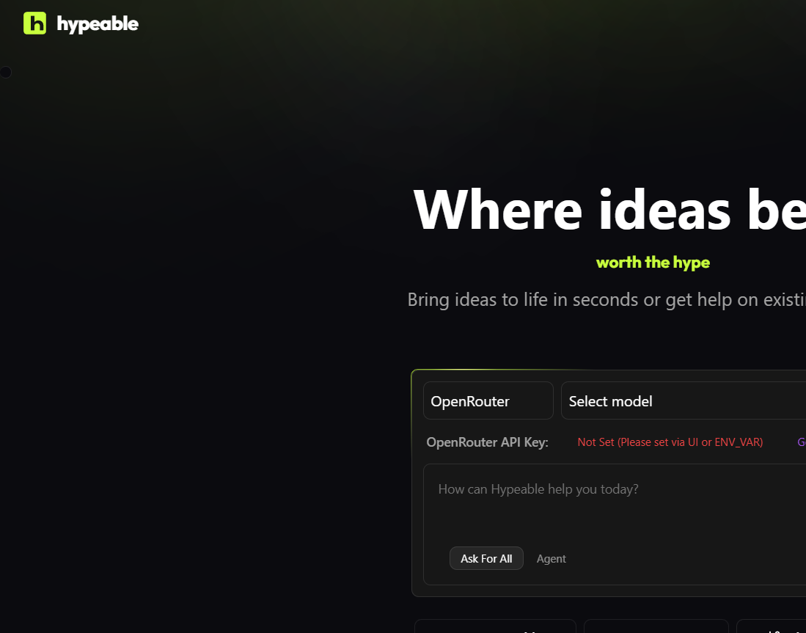

# Hypeable



**Worth the hype.** A free, open-source AI app builder. Describe an app, watch it get built, publish it to your own Vercel or GitHub.

> Not affiliated with Lovable, Bolt, or StackBlitz. Built on [bolt.diy](https://github.com/stackblitz-labs/bolt.diy) (MIT).

## Live cost meter

The header pill is session spend in dollars. Click it for today, per-model totals, and cap progress. Caps default to $2/session and $10/day (`0` = off). They are enforced in this browser; set a limit on your provider too.

Unknown models show tokens plus a prompt to set a price in Settings. Copy receipt produces a shareable line such as `Built with Hypeable: $0.42 | 38k tokens | claude-x, gpt-y | hypeable.dev`.

Details: [docs/COST-METER.md](docs/COST-METER.md).

## Why Hypeable
| Problem with typical AI builders | What Hypeable does |
|---|---|
| Surprise bills, you only find out after | **Live cost meter** in dollars, with session and daily caps and a hard stop |
| The AI loops on the same error and burns credits | **Loop breaker** stops after 3 repeats and offers replan / revert / switch model |
| It starts coding before agreeing on what to build | **Plan-first mode**, you approve the plan first |
| Apps ship with exposed keys and open databases | **Pre-deploy security check** |
| Lock-in and hosting | You bring your key and publish to **your own** Vercel/GitHub |

## Status
Early. Built in public. See [docs/ROADMAP.md](docs/ROADMAP.md).

## Quick start
```bash
git clone https://github.com/treyyha/hypeable && cd hypeable
pnpm install         # Husky hooks: secret-scan + conventional commits
npm run setup        # creates .env.local if missing, runs a full secret scan
npm run dev
```
Add your own model key in the app's settings. Stored in your browser. Sent over HTTPS to this app's server for each request, used once for that request to your provider, never stored or logged. Verify it in [`app/routes/api.chat.ts`](app/routes/api.chat.ts). Want zero trust? Run Hypeable locally: `pnpm dev`.

## Run locally
Hypeable's server sees your key for the duration of each LLM request so it can forward the call to your provider. If you do not want that hop, run the app on your machine:

```bash
git clone https://github.com/treyyha/hypeable && cd hypeable
pnpm install
pnpm dev
```

Then open the printed local URL (typically `http://localhost:5173`). Keys stay on your computer; the only network call with the key is from your local process to the model provider you chose.

## Contributing
Read [CONTRIBUTING.md](CONTRIBUTING.md). Commits follow [Conventional Commits](https://www.conventionalcommits.org).

## Security
See [SECURITY.md](SECURITY.md) and [docs/SECURITY.md](docs/SECURITY.md).

## License
MIT. Base code from bolt.diy is MIT as well; see [NOTICE.md](NOTICE.md).
> Note: StackBlitz WebContainers is free for personal/open-source use. Commercial hosted use needs a StackBlitz license.
