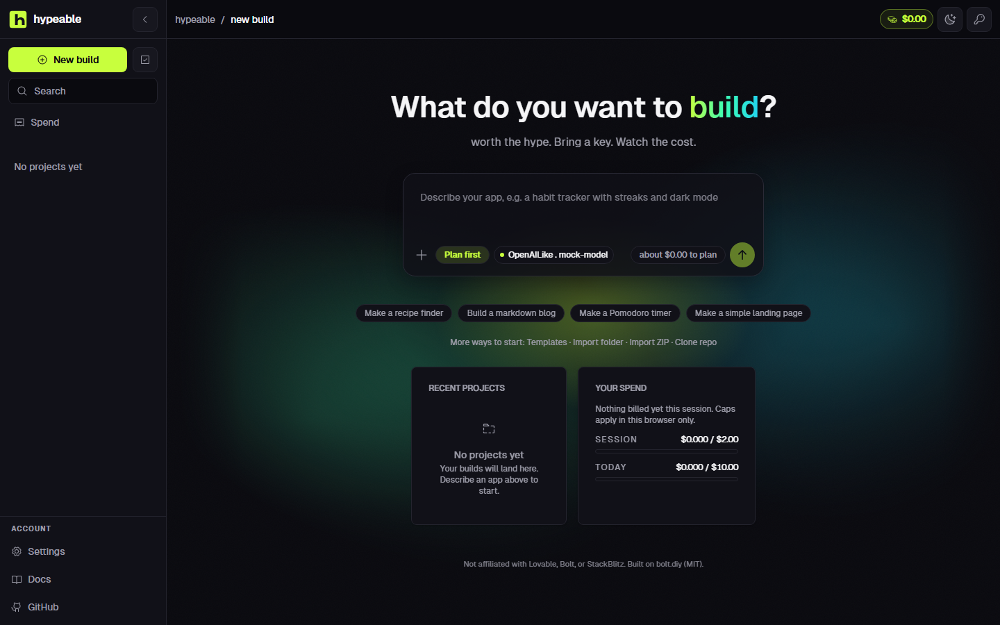
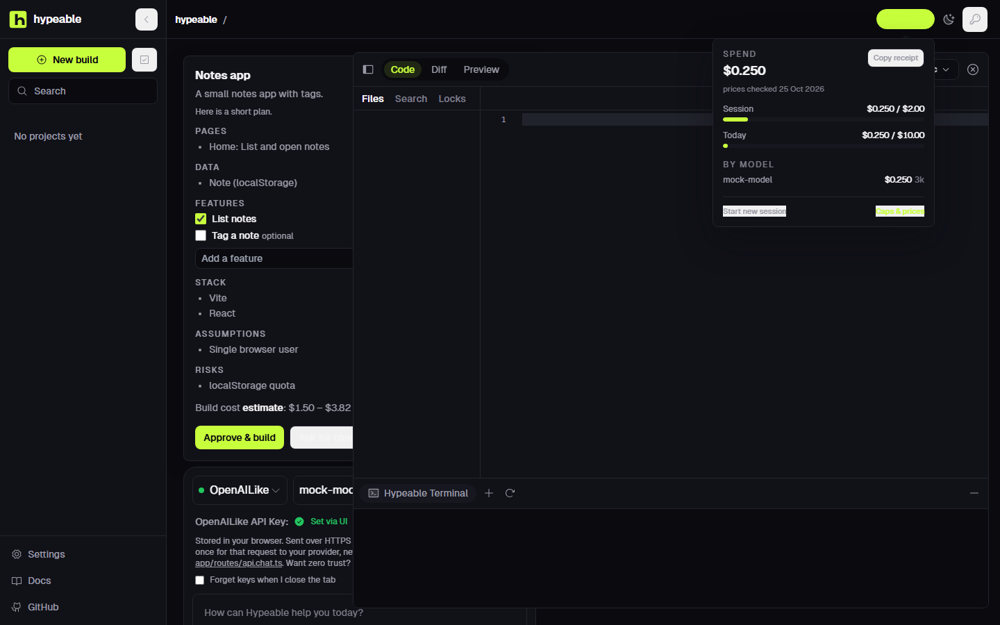
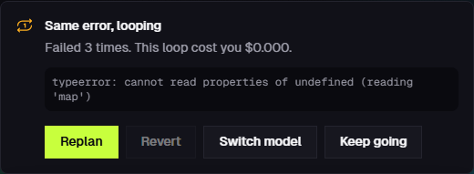
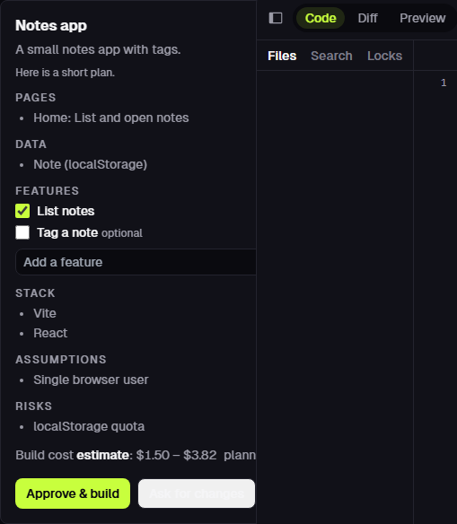
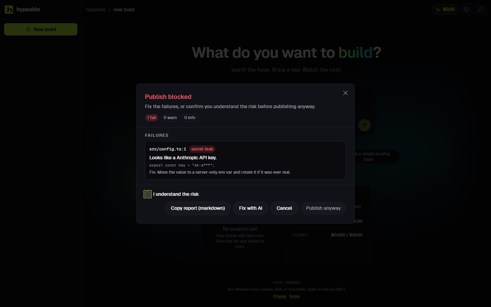
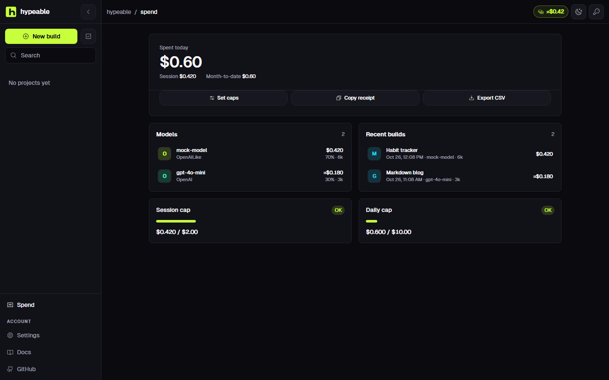

<p align="center">
  
</p>

<p align="center"><strong>worth the hype.</strong> A free, open-source AI app builder.</p>

<p align="center">
  <a href="https://github.com/treyyha/hypeable/actions/workflows/ci.yml"></a>
  <a href="LICENSE"></a>
  <a href="https://github.com/treyyha/hypeable/stargazers"></a>
</p>

<p align="center"><a href="https://hypeable.dev"><strong>Try it: hypeable.dev</strong></a></p>



Describe an app, watch it get built, publish it to **your own** Vercel or GitHub. Connect with OpenRouter in one click (you pay them directly) or paste any provider key. Hypeable hosts nothing and has no Hypeable-owned deploy target.

> Not affiliated with Lovable, Bolt, or StackBlitz. Built on [bolt.diy](https://github.com/stackblitz-labs/bolt.diy) (MIT).

## Why Hypeable

### Live cost meter

The header pill is session spend in dollars. Click it for today, per-model totals, and cap progress. Caps default to $2/session and $10/day (`0` = off). They are enforced in this browser; set a limit on your provider too. Unknown models show tokens plus a prompt to set a price in Settings.



Details: [docs/COST-METER.md](docs/COST-METER.md).

### Loop breaker

If the same error (or the same file rewrite) repeats 3 times, Hypeable stops the run — same as hitting Stop — and shows a panel: the error, how many times it failed, and what the loop cost. Replan, revert to before the loop, switch to a stronger model you already have a key for, or keep going.



Details: [docs/LOOP-BREAKER.md](docs/LOOP-BREAKER.md).

### Plan-first mode

On by default. The first build in an empty workspace (or every request, if you turn that on) returns a plan card — pages, data, features you can tick, and a dollar **estimate** range — before any code is written. Approve, ask for changes, or skip.



Details: [docs/PLAN-MODE.md](docs/PLAN-MODE.md).

### Pre-deploy security check

Before you publish a generated app to your own Vercel, Netlify, GitHub, or GitLab, Hypeable scans the files in this browser and shows a pass / warn / fail report. The Vercel and Netlify proxies scan again on the server so a direct API call cannot skip it. Secrets are masked (`sk-a***`). Failures need an explicit “I understand the risk” check.



Details: [docs/PREDEPLOY-CHECK.md](docs/PREDEPLOY-CHECK.md).

### Spend page

`/spend` (also in the sidebar with New build / Search) shows today, session, month-to-date, a 7-day chart, per-model share, recent builds, and cap progress from this browser only. Empty browsers show the empty state.



## Quick start

```bash
git clone https://github.com/treyyha/hypeable && cd hypeable
pnpm install         # Husky: secret-scan + lint-staged on commit, typecheck on push
npm run setup        # creates .env.local if missing, runs a full secret scan
npm run dev
```

Click **Connect with OpenRouter** on the empty home (or paste a key in Settings). You pay OpenRouter directly. Hypeable never sees your card and does not store your key on a server — it lives in this browser. Sent over HTTPS for each model request, never stored or logged. There is no analytics beacon; fonts are self-hosted; Hypeable does not phone home for updates. WebContainer (`*.webcontainer-api.io`) starts only when you build. Report vulnerabilities at [hypeable.dev/.well-known/security.txt](https://hypeable.dev/.well-known/security.txt).

## Run locally

The public site at [hypeable.dev](https://hypeable.dev) cannot reach local models. For Ollama, LM Studio, or a custom OpenAI-compatible URL, run Hypeable on your machine:

```bash
git clone https://github.com/treyyha/hypeable && cd hypeable
pnpm install
pnpm dev
```

Then open the printed local URL (typically `http://localhost:5173`). Keys stay on your computer; the only network call with the key is from your local process to the model provider you chose.

Deploy: [docs/DEPLOY.md](docs/DEPLOY.md).

## Hosted vs local

| Capability | Hosted (`hypeable.dev` or `HYPEABLE_HOSTED=1`) | Local / `HYPEABLE_SELF_HOSTED=1` |
|---|---|---|
| First-party providers (OpenAI, Anthropic, Google, OpenRouter, Groq, and others in Settings) | Yes, BYO key in the browser | Yes |
| Custom OpenAI-compatible base URL, Ollama, LM Studio | Rejected: "Run Hypeable locally to use custom endpoints" | Yes |
| Git proxy | `github.com` / `gitlab.com` (git smart-HTTP only) | Open |
| MCP, bug-report, update, `/api/system/*`, `/api/git-info`, `/api/check-env-key` | 404 | Yes |
| `/api/export-api-keys` | 410 (keys are browser-only) | 410 |
| WebContainer preview | Yes | Yes |

## How your key and tokens travel

Model keys and connector tokens (GitHub, GitLab, Vercel, Netlify, Supabase) live in the browser (`localStorage` or `sessionStorage`). They are sent **only** on the relevant request, over HTTPS, in a header or JSON body. The server never falls back to an operator env token. It is not written to disk, cookies, or a database. Logs run through redaction (`sk-…`, `Authorization`, `x-hypeable-key`, `glpat-`, `github_pat-`).

GitHub and GitLab **publish** talk to the provider from the browser (CORS). Vercel and Netlify **publish** take a one-shot hop through Hypeable so we can scan files, then the files land in **your** account. Want zero trust? Run locally: `pnpm dev`.

Verify the path in [`docs/KEY-FLOW.md`](docs/KEY-FLOW.md), LLM keys in [`app/routes/api.chat.ts`](app/routes/api.chat.ts), and connectors in [`app/lib/api/connector-tokens.ts`](app/lib/api/connector-tokens.ts).

## Honest limits

- **Hosted cannot reach local models.** Ollama, LM Studio, and custom OpenAI-compatible URLs are rejected on the public site. Run locally.
- **Publish connectors are experimental.** GitHub, GitLab, Vercel, Netlify, and Supabase are wired to **your** account with your token and a pre-deploy scan. None of them has a live end-to-end deploy in CI. Token readers, hosted API locks, and the pre-deploy scanner do have automated tests.
- **WebContainers licence.** StackBlitz WebContainers is free for personal and open-source use. Commercial hosted use needs a StackBlitz license.
- **Prices marked ≈ are unverified.** `app/lib/cost/prices.json` is a community list-price table. Rows with `verified: false` show as estimates (`≈`) in the UI.
- **Estimates, not invoices.** The meter multiplies tokens by list prices (or uses a provider-reported cost when one exists). It is not your provider bill. Set a limit on your provider too.
- **CI unit tests and e2e are blocking.** Wall-clock frame-budget / Shiki timing runs in a non-blocking `perf` job. See [docs/TESTING.md](docs/TESTING.md) and [docs/KNOWN-ISSUES.md](docs/KNOWN-ISSUES.md).
- **Home first-load JS is budgeted.** `docs/first-load-budget.json` is checked after `pnpm build`. See [docs/FIRST-LOAD.md](docs/FIRST-LOAD.md).
- **Started chat below 1024px** uses a Chat | Preview | Code tab switch. Shots: `docs/assets/home-*-375.png`, `chat-*-768.png`, etc.

## Roadmap

Built in public. See [docs/ROADMAP.md](docs/ROADMAP.md). Next up includes direct browser-to-provider mode where the provider's CORS allows it.

## Contributing

Read [CONTRIBUTING.md](CONTRIBUTING.md). Commits follow [Conventional Commits](https://www.conventionalcommits.org). Price corrections use the **Wrong price** issue template and the `pricing` label.

Related unit tests: `npm run test:related`. Commit locally with `npm run ship -- "type(scope): summary"`; push and watch CI once with `npm run finish`. Details: [docs/TESTING.md](docs/TESTING.md).

## Security

See [SECURITY.md](SECURITY.md) and [docs/SECURITY.md](docs/SECURITY.md). Please do not open a public issue for vulnerabilities — use GitHub's private reporting.

## Credits

- [bolt.diy](https://github.com/stackblitz-labs/bolt.diy) (MIT) — the base this fork started from. See [LICENSE](LICENSE) and [NOTICE.md](NOTICE.md).
- [KokonutUI](https://github.com/kokonut-labs/kokonutui) (MIT) — layout patterns ported into `app/components/ui/` and the Spend page, restyled to Hypeable tokens. See [NOTICE.md](NOTICE.md).
