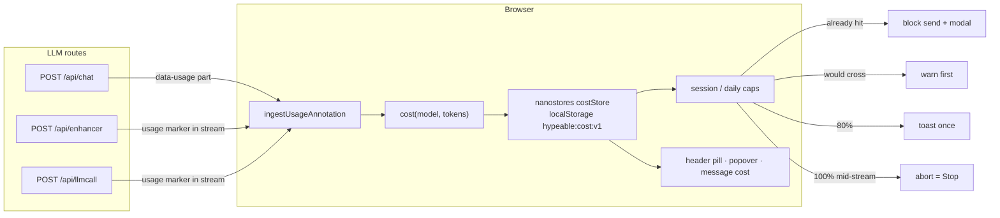

# Live cost meter

Hypeable's headline guardrail: you always see what this browser has spent, and a request that would overshoot your cap is stopped. The header pill is a tinted accent chip (`$0.00` at zero): lime text on dark, `#4D7A00` on light, amber at 80% of a cap and red at 100%.

Caps are enforced **in this browser**. They protect you from accidental loops. Provider-side spending limits are the real backstop.

## Data

1. The provider reports token usage (and, on OpenRouter, a billed `cost`).
2. `app/lib/cost/calc.ts` multiplies tokens by list prices in `prices.json` (per 1M input / output, optional cached input). Local providers (Ollama, LM Studio) are $0.
3. Unknown models stay unknown: the UI shows tokens plus **price unknown, set it**. Custom per-model prices live in settings.
4. Totals persist in `localStorage` key `hypeable:cost:v1`. Corrupted or missing storage falls back to zeros.

## Caps

Defaults: **$2 session**, **$10 daily**. `0` turns a cap off.

| Point | Behaviour |
|---|---|
| Before send, cap already hit | Block. Modal: "Cap reached: $X of $Y". Raise cap / Start new session. |
| Before send, estimate would cross | Warn first. Send anyway / Cancel / Raise cap. |
| 80% | Warning toast once per cap until it is raised or the day/session resets. |
| 100% mid-stream | Abort on the same path as the Stop button. Same modal. |

## Prices

`prices.json` is tagged with `checkedAt` and a `source` URL per provider. The meter popover shows `prices checked <date>`. Rows with `verified: false` are best-effort estimates: the UI prefixes the amount with **≈** and a "price unverified" tooltip.

OpenRouter's billed usage cost, when present, wins over the table.

## Cached tokens

Provider usage sometimes includes cache-read (`cachedTokens`, `cacheRead`, `cache_read_input_tokens`) and cache-write (`cacheWrite`, `cache_creation_input_tokens`) counts.

- **Cache-read** is billed at `cachedInput` when that rate exists on the row.
- **Cache-write** has no dedicated rate in `prices.json`, so it is billed as normal input.
- If cache tokens are present but the row has no `cachedInput`, they are also billed as normal input.

Anthropic-style blobs report uncached `input_tokens` plus sibling cache fields; those cache tokens are added into the prompt total. OpenAI-style blobs already include cache-read inside `prompt_tokens`.
