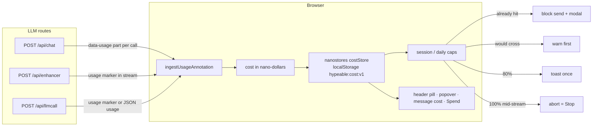

# Live cost meter

Hypeable's headline guardrail: you always see what this browser has spent, and a request that would overshoot your cap is stopped. The header pill is a tinted accent chip (`$0.00` at zero): lime text on dark, `#4D7A00` on light, amber at 80% of a cap and red at 100%.

A number **without** ≈ is provider-reported usage priced from the official table, or OpenRouter's billed `usage.cost`. A number **with** ≈ is an estimate. Accuracy against provider invoices is tracked in [COST-ACCURACY.md](COST-ACCURACY.md) (empty until a real-key comparison is published). The README still calls the pill an estimate until that file has rows.

Caps are enforced **in this browser**, across all its tabs: each tab reloads the shared `hypeable:cost:v1` snapshot before it adds usage or checks a cap, and a `storage` event refreshes the pill. They protect you from accidental loops. Provider-side spending limits are the real backstop.

## How a number is produced

1. The provider returns token usage (and, on OpenRouter, a billed `cost`). Chat Completions streams request `stream_options.include_usage` so that chunk is present. Anthropic sends usage on `message_start` / `message_delta`. Google sends `usageMetadata` on the final generateContent chunk. OpenRouter always includes usage and `cost` on the last Chat Completions chunk.
2. `app/lib/cost/usage.ts` maps that blob into input / output / cache-read / cache-write / reasoning / image counts. Field names come from each provider's current API docs.
3. `app/lib/cost/calc.ts` multiplies those counts by list prices in `prices.json` using **integer nano-dollars** (1e-9 USD). The pill, session total, and cap check all read the same micro-dollar rounding of that sum.
4. OpenRouter's billed `usage.cost`, when present, is the **authoritative** dollar figure for that call. The table estimate is stored beside it as `computedCost`. A non-zero `divergenceNanos` means the two disagreed.
5. Unknown models stay unknown: the UI shows tokens plus **price unknown, set it**. Custom per-model prices live in settings.
6. Totals persist in `localStorage` key `hypeable:cost:v1`. Corrupted or missing storage falls back to zeros.
7. A compact build ledger (last 200 settled usages) lives in `hypeable:spend-ledger:v1`. The **Spend** page (`/spend`) reads the meter and this ledger in the browser only.

## When the number is exact

The pill, popover, Spend page, and export show a plain dollar amount when **all** of these are true:

- The provider returned a usage blob (not a local tokenizer guess).
- Every token category we received has a matching price field, **or** OpenRouter returned `usage.cost` and we used that.
- The list-price row is `verified: true` (or the figure is OpenRouter-reported).
- The stream finished; final usage arrived.

OpenRouter-routed calls with `usage.cost` are labelled from the billed number even if our table disagrees. The export still includes `computed_cost` so you can compare.

| Provider | Usage source | Stream flag | Notes |
|---|---|---|---|
| OpenAI | `usage` on the Chat Completions body / final empty-choices chunk | `stream_options.include_usage` | Reasoning tokens already sit inside `completion_tokens`. |
| OpenRouter | Always `usage` + billed `cost` on the last chunk | Flag is a no-op | `usage.cost` is authoritative; table estimate kept beside it. |
| Anthropic | `message_start.usage` then cumulative `message_delta.usage` | None | `input_tokens` is uncached; add cache siblings. Do not sum start+delta. |
| Google | `usageMetadata` on the last generateContent chunk | None | `thoughtsTokenCount` billed as extra output. |
| DeepSeek, xAI, Groq, Mistral | OpenAI-compatible `usage` | `stream_options.include_usage` | DeepSeek may put usage on the last content chunk. |
| GitHub, Together, Fireworks, Cerebras, Hyperbolic, Moonshot, Hugging Face, Perplexity, Z.AI, OpenAI-like | Same Chat Completions `usage` | `stream_options.include_usage` | Via the shared fetch wrapper. |
| Cohere, Amazon Bedrock | AI SDK `usage` (`inputTokens` / `outputTokens`) | None | Exact when the SDK surfaces usage; otherwise ≈. |
| Ollama, LM Studio | Local | n/a | $0, not an estimate. |

## When the number is an estimate (≈)

The UI prefixes **≈** when any of these apply:

| Reason | What happened |
|---|---|
| `local-estimate` | No provider usage (aborted stream, or a mid-send cap estimate). Tokens are `ceil(chars / 4)`. |
| `unpriced-category` | We received cache-write, cache-read, reasoning, or image tokens the row has no rate for. Those tokens are billed at the closest rate (usually input or output) rather than ignored. |
| `unverified-price` | The `prices.json` row is `verified: false`. |
| `aborted` | The stream was cancelled before the final usage chunk. |
| `failed-maybe-billed` | The call errored after the provider may already have billed it. |
| `unknown-model` | No table or custom price. Tokens are kept; dollars stay 0. |

Local providers (Ollama, LM Studio) are $0 and not estimates.

## Token categories

| Category | Price field | Notes |
|---|---|---|
| Uncached input | `input` | Anthropic `input_tokens` is already uncached. OpenAI-style `prompt_tokens` includes cache-read. |
| Cache-read | `cachedInput` | Missing rate → billed as input and marked ≈. |
| Cache-write (5 min) | `cacheWrite` | Anthropic 5-minute write from the official pricing table. Missing → billed as input, ≈. |
| Cache-write (1 hour) | `cacheWrite1h` | Anthropic 1-hour write. Missing → billed as `cacheWrite` or input, ≈. |
| Output | `output` | OpenAI / DeepSeek / xAI reasoning tokens are already inside `completion_tokens`. |
| Reasoning (extra) | `output` | Google `thoughtsTokenCount` is **added** to output; Gemini bills thinking as output. |
| Image | `image` | Usually already inside prompt tokens. A dedicated rate is used when the row has `image`; otherwise ≈. |

`prices.json` rows are tagged with `checkedAt` and a `source` URL. `verified: true` only when the number came from that official page on `checkedAt`.

## Every call counts

| Path | How it reports |
|---|---|
| Chat (`POST /api/chat`) | `data-usage` part on stream end |
| Plan-first | Same as chat, `callKind: plan` |
| Context summary / file select | Separate `data-usage` parts (`summary`, `context`) |
| Loop-breaker replan / retry | A new chat turn |
| Prompt enhancer | Usage marker at the end of the text stream |
| `POST /api/llmcall` stream | Same marker as the enhancer |
| `POST /api/llmcall` JSON | `usage` on the JSON body (`toLlmCallResponse`) |
| Aborted stream | Tokens seen so far, marked ≈ and maybe-billed |
| Failed call that may still be billed | Counted, marked maybe-billed |

There is no separate title/summary LLM call outside `/api/chat`. Starter-template titles are sliced from the user message.

## Caps

Defaults: **$2 session**, **$10 daily**. `0` turns a cap off.

| Point | Behaviour |
|---|---|
| Before send, cap already hit | Block. Modal: "Cap reached: $X of $Y". Raise cap / Start new session. |
| Before send, estimate would cross | Warn first. Send anyway / Cancel / Raise cap. |
| 80% | Warning toast once per cap until it is raised or the day/session resets. |
| 100% mid-stream | Abort on the same path as the Stop button. Same modal. |

The cap check uses `snapshot.sessionTotal` / `dailyTotal`, which are the micro-dollar rounding of the nano-dollar running total — the same numbers the pill shows.

## Export for a real-key test

On **Spend**, **Copy usage JSON** and **Download CSV** write one row per model call: timestamp, provider, model, input / output / cache-read / cache-write / reasoning / image tokens, our computed cost, provider-reported cost if any, exact-or-estimate flag.

The files contain no API keys, prompts, file contents, or chat names. Compare them to the provider usage page with the method in [COST-ACCURACY.md](COST-ACCURACY.md).
