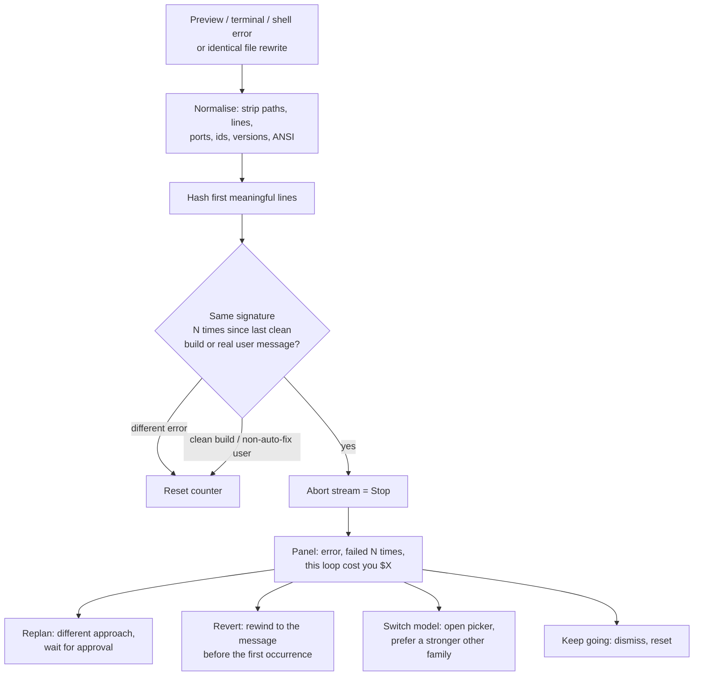

# Loop breaker

When the model hits the same error over and over, Hypeable stops the run so it cannot keep spending, and offers a way out.

Everything stays in this browser. There is no telemetry.

## Detection

Source signals:

- Action / terminal / preview error alerts (the same ones that offer "Ask Hypeable")
- Failed shell / start / build actions that raise those alerts
- The same file rewritten with identical content

Each error is normalised (absolute paths, line/column numbers, timestamps, hex ids, ports, versions, ANSI codes) and hashed. A different error resets the counter. A successful build or start resets it. A user message that is **not** an auto-fix (`*Fix this … error*`) resets it.

Threshold defaults to **3**, configurable 2–5, or the feature can be turned off in Settings.

## When it fires

1. The active stream is aborted on the same path as the Stop button (once).
2. A panel shows the normalised error (truncated, expandable), how many times it failed, and dollars wasted since the first occurrence (from the cost meter).
3. Four actions:
   - **Replan** — send a structured message that states the error, lists what was already tried, and tells the model to explain a new plan in plain steps and wait for approval before writing code.
   - **Revert** — rewind the chat to the last real user message before the loop started (`?rewindTo=`).
   - **Switch model** — open the model picker and preselect a stronger model the user already has a key for, preferring a different provider family. Chat context is kept.
   - **Keep going** — dismiss the panel and reset the counter.

## Store

`loopStore` exposes `{ isLooping, signature, count, wastedCost }` so plan-first mode and the pre-deploy check can read it later. Settings live in `localStorage` key `hypeable:loop:v1`.

## Demo

In a development build, open `/?debugLoop=1` (or `/chat/<id>?debugLoop=1`). The hook feeds three identical preview errors so the panel appears without a real loop.
