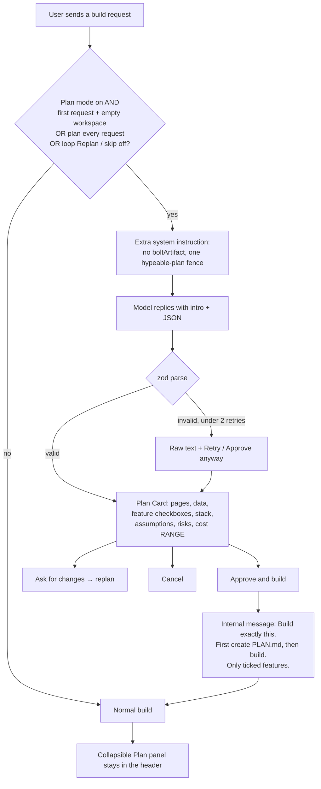

# Plan-first mode

Before any code is written, Hypeable shows a plan with an honest cost range. You approve it, then the build starts. That is the point: stop a wasted build before it spends.

Plan mode is **on by default**. Settings live in this browser only (`hypeable:plan:v1`). There is no telemetry.

## Gate

A planning turn happens when chat mode is **build** and:

1. **Skip plan** was not clicked for this message, and
2. either **force** (loop Replan, or Ask for changes), or
3. plan mode is on and **Plan every request** is on, or
4. plan mode is on, this is the **first user message** in the chat, and the workspace is **empty**.

The planning request adds `planMode: true` to `POST /api/chat`. The server appends the planning instruction, skips project tools, and does not start the agent loop. The model must not emit `boltArtifact` actions.

Each composer has a **Plan first** chip in build mode. Selected means plan mode is on; clicking toggles the real plan-mode setting in both directions.

## Card

Dark, lime accent. Title, summary, pages, data, features (optional ones unchecked; you can untick or add a line), stack, assumptions, risks. All plan text is plain text — HTML from the model is stripped and never interpreted.

Buttons: **Approve & build**, **Ask for changes**, **Cancel**. Invalid JSON shows the raw fence with **Approve anyway** and **Retry** (max 2).

## Cost estimate

A **range** in dollars, labelled estimate: selected model price × a token range from plan size (pages + features). If this browser has previous completed builds, their median and spread blend into the range. The planning-call cost is shown separately. Unverified list prices use the same **≈** / “price unverified” rules as the meter. Unknown models stay unknown.

## After approve

The follow-up user message is: *Build exactly this. First create PLAN.md in the project containing the approved plan, then build.* Only ticked features are included. Plan gating is off for that turn.

The approved plan stays in a collapsible **Plan** control in the header. `PLAN.md` is part of the generated project because the build prompt requires it.

## Loop breaker

**Replan** on the loop panel forces a planning turn and includes the repeated error and what was already tried as context.

## Settings

Settings → Plan-first mode:

- Plan mode on/off (default on)
- Plan every request on/off (default off)
