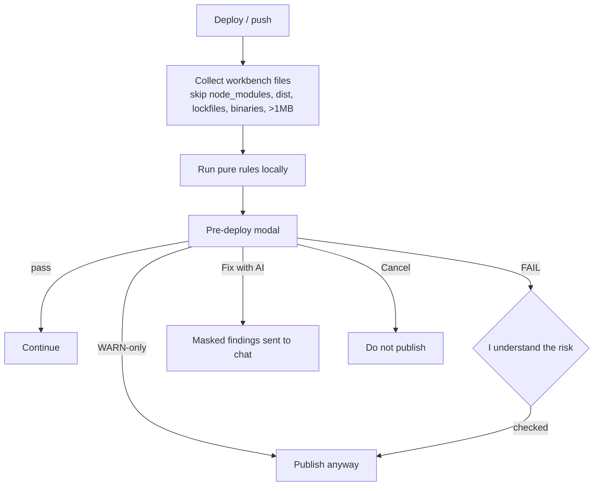

# Pre-deploy security check

Before any publish (Vercel, Netlify, GitHub, GitLab) of a generated app, Hypeable scans the project **in this browser** and shows a pass / warn / fail report. Nothing is uploaded. There is no telemetry.



Secret patterns are shared with the git hook: [`app/lib/security/secret-patterns.json`](../app/lib/security/secret-patterns.json) is the single catalog used by `scripts/secret-scan.mjs` and the in-app scanner.

Findings never store a full secret: each match is reduced to the first four characters plus `***`.

## Rules

| id | severity | why | example | how to fix | false positives |
|---|---|---|---|---|---|
| `secret-leak` | FAIL | A known key/token pattern is in a file | `sk-ant-…` in `src/config.ts` | Move to a server-only env var and rotate if it was real | Test fixtures: add `hypeable-ignore: secret-leak reason` |
| `client-secret` | FAIL | `service_role` or a secret-named `VITE_` / `NEXT_PUBLIC_` / `PUBLIC_` env is in client code | `process.env.VITE_SUPABASE_SERVICE_ROLE_KEY` | Use the anon key in the browser; keep service role on the server | Rename the env if it is truly publishable |
| `dotenv-committed` | FAIL | `.env` has real values, or `.env` is not gitignored | `.env` with `OPENAI_API_KEY=…` | Delete `.env` from the project and add `.env` to `.gitignore` | `.env.example` with placeholders is ignored |
| `supabase-rls-missing` | FAIL | SQL `CREATE TABLE` without `ENABLE ROW LEVEL SECURITY` | `CREATE TABLE notes (…)` | `ALTER TABLE notes ENABLE ROW LEVEL SECURITY;` plus real policies | Views/materialized tables: ignore comment |
| `supabase-rls-open` | FAIL | Anon/public write policy uses `USING (true)` / `WITH CHECK (true)` | `CREATE POLICY … TO anon FOR ALL USING (true)` | Restrict to `authenticated` and a row check | Read-only `SELECT` policies are not flagged |
| `firebase-open-rules` | FAIL | Firestore/RTDB rules allow anyone | `allow read, write: if true` | Require `request.auth != null` and lock down writes | Emulator-only rules: ignore comment |
| `cors-wildcard` | WARN | `Access-Control-Allow-Origin: *` (worse with credentials) | `res.setHeader('Access-Control-Allow-Origin', '*')` | List explicit origins | Docs snippets: ignore comment. **Heuristic.** |
| `localstorage-token` | WARN | Auth tokens written to `localStorage` | `localStorage.setItem('access_token', jwt)` | HttpOnly cookie or in-memory session | Non-auth keys named “token”: ignore. **Heuristic.** |
| `unsafe-html` | WARN | `dangerouslySetInnerHTML` or `eval` with a non-literal | `__html: userHtml` | Render text, or sanitize if HTML is required | Static HTML strings are allowed. **Heuristic.** |
| `insecure-http` | WARN | `http://` API URL (not localhost) | `fetch('http://api.example.com')` | Use `https://` | `localhost` / `127.0.0.1` / w3.org schema URLs are skipped |
| `client-admin-check` | WARN | Admin decided from localStorage / local state | `const isAdmin = localStorage.getItem('role')` | Enforce admin on the server from the session | UI-only badges: ignore. **Heuristic.** |
| `supabase-rls-unverified` | INFO | `.from('x')` with no matching SQL migration | `supabase.from('notes')` and no `CREATE TABLE notes` | Check Authentication > Policies in your Supabase dashboard (30 seconds) | Dashboard-managed schema: the files cannot prove RLS. **Heuristic.** |
| `unauthenticated-write` | WARN | API handler writes to a DB and never mentions a session | `db.from('items').insert(body)` in `app/api` | Check auth before insert/update/delete | **Heuristic, verify.** |
| `client-price-trust` | WARN | Request-body price/amount used in a payment call | `stripe.charges.create({ amount: body.amount })` | Look up price on the server from a product id | **Heuristic, verify.** |
| `unpinned-dependency` | WARN | `package.json` uses `*` or `latest` | `"react": "*"` | Pin a version you have tested | Caret/tilde ranges are allowed |
| `missing-security-headers` | INFO | No CSP / frame / HSTS config found | Empty project | Add headers in `vercel.json` or Netlify `_headers` | **Heuristic.** |
| `missing-gitignore` | INFO | No `.gitignore` | — | Add `.env`, `node_modules`, `dist` | — |

Heuristic rules are labelled **heuristic, verify** in the modal.

## Ignore comments

On the same line or the line above:

```ts
export const demo = "sk-ant-" + "a".repeat(24); // hypeable-ignore: secret-leak fake key for a unit test secret-scan:allow
```

Suppressed findings still appear in the report under **Suppressed**. They do not fail the gate.

## Gating

| Outcome | Continue |
|---|---|
| PASS (info-only is still pass) | **Continue**. INFO findings sit under one collapsed **Info** section. |
| WARN-only | **Publish anyway** (no checkbox) |
| Any FAIL | Checkbox **I understand the risk**, then **Publish anyway** |

**Fix with AI** sends the masked markdown report into chat. **Copy report (markdown)** copies the same text.

## Contributing a rule

1. Add a pure function in `app/lib/predeploy/rules/` with the shape `(files: Record<string, string>) => Finding[]`.
2. Register it in `app/lib/predeploy/registry.ts`.
3. Add a **vulnerable** fixture in `app/lib/predeploy/fixtures.ts` and assert the rule id fires in `scan.spec.ts`.
4. Keep the **clean** fixture at zero findings. If your rule flags it, the rule is too greedy.
5. Never put a full secret in a Finding. Use `maskSnippet`. Construct fake keys at runtime so `secret-scan` does not block the commit.
6. Document the rule in the table above (id, severity, why, example, fix, false-positive handling).
7. Mark uncertain rules `heuristic: true`.

Skip `node_modules`, `dist`, `build`, `.git`, lockfiles, binaries, and files over 1 MB.

Target: under 1 second for 500 files. Duration is logged with `console.info` in development only.
